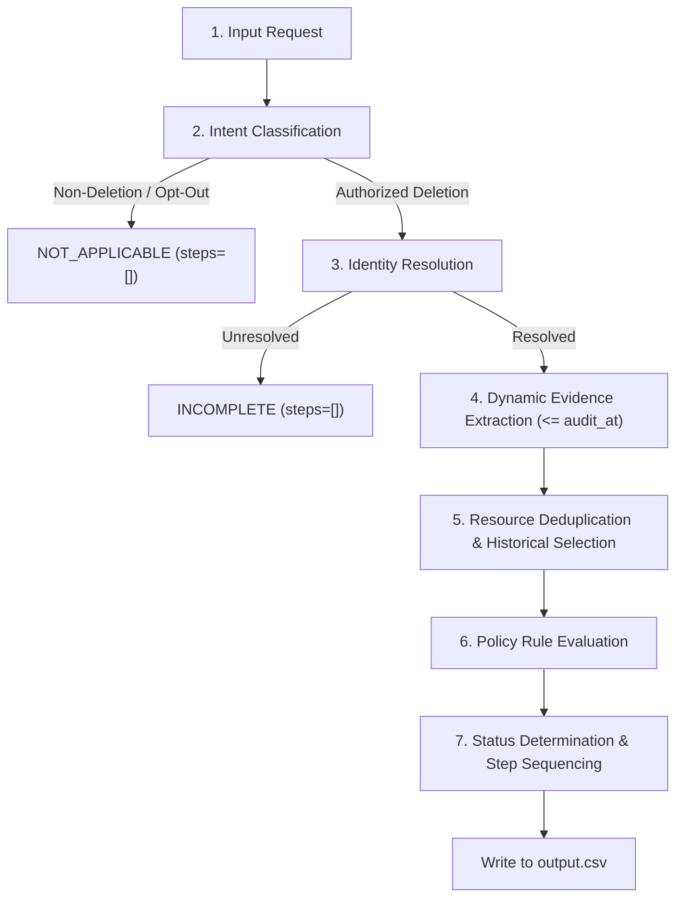

# Usage & Operations Report: Deletion Audit Pipeline

## 1. Project Overview & Scope

The **Deletion Audit Pipeline** is an automated, deterministic audit system developed for the HackerRank Orchestrate challenge: *Ghost Data Still Exists*.

Its purpose is to independently audit deletion requests across distributed enterprise systems (databases, failover replicas, structured application logs, customer support tickets, search indexes, backups, and data exports). The system evaluates whether personal data was truly deleted, redacted, anonymized, or retained according to legal and business policies, establishing the true ground-truth state at a specific historical point in time (`audit_at`).

---

## 2. Prerequisites & Dependencies

The pipeline is implemented in pure, cross-platform Python 3 without requiring external cloud services, heavy runtimes, or paid API keys.

### System Requirements
* **Python:** Python 3.10 or later
* **Operating System:** Linux, macOS, or Windows
* **External Runtime Services:** None (100% offline and self-contained)

### Dependencies
The pipeline relies on the Python standard library for maximum portability and deterministic execution:
* `csv`, `json`: Data parsing, validation, and serialization
* `argparse`: Command-line interface
* `sqlite3`: In-memory and file-based execution of SQLite database replicas
* `re`: Regular expressions for log and intent parsing
* `datetime`: ISO-8601 timestamp comparison and audit cutoff enforcement
* `logging`: Structured diagnostics and warning logs
* `pypdf` *(optional)*: Text extraction from PDF documents if installed (gracefully handled if absent)

---

## 3. Repository Architecture & Core Modules

```text
hackerrank-orchestrate-october26/
├── code/
│   ├── main.py                 # Pipeline orchestrator, CLI entry point, and step ordering
│   ├── identity.py             # User identity snapshot and historical audit log resolver
│   ├── evidence_reader.py      # Multi-format evidence extraction (SQL, JSON, logs, text)
│   ├── resource_linker.py      # Dynamic resource association and activity log correlation
│   ├── policy.py               # Deletion rules engine, intent heuristic, and step sorting
│   └── test_*.py               # Automated regression suite (113 tests)
├── dataset/                    # Participant-facing data and evidence repository
│   ├── deletion_requests.csv   # 518 evaluation deletion requests
│   ├── user_identities.csv     # Current user profile snapshots
│   ├── user_audit_log.csv      # Historical identity changes
│   ├── system_activity.csv     # Global system activity stream
│   ├── deletion_rules.csv      # Data category policy definitions
│   ├── evidence_files.csv      # Manifest mapping file IDs to paths and origins
│   └── evidence/               # Multi-source evidence directory (databases, logs, records)
├── evaluation/
│   ├── evaluation_report.md    # Evaluation results, parity analysis, and regression protections
│   └── usage_report.md         # This usage, execution, and operations guide
├── output.csv                  # Challenge prediction output file (518 rows)
└── AGENTS.md                   # Single source of truth for challenge specifications and rules
```

### Module Responsibilities

* **`code/main.py` ([DeletionAuditPipeline](file:///c:/Users/mayan/hackerrank-oct26/hackerrank-orchestrate-october26/code/main.py#L57)):**
  The central coordinator. Handles CLI arguments, invokes intent classification, calls evidence collection, executes historical state deduplication, evaluates policy rules, formats JSON steps, and writes `output.csv`.
* **`code/identity.py` ([IdentityResolver](file:///c:/Users/mayan/hackerrank-oct26/hackerrank-orchestrate-october26/code/identity.py)):**
  Resolves requester emails against current profiles (`user_identities.csv`) and historical changes (`user_audit_log.csv`), recovering historical emails, names, phone numbers, and SHA-256 hashes.
* **`code/evidence_reader.py` ([SqlEvidenceReader](file:///c:/Users/mayan/hackerrank-oct26/hackerrank-orchestrate-october26/code/evidence_reader.py#L182), [JsonEvidenceReader](file:///c:/Users/mayan/hackerrank-oct26/hackerrank-orchestrate-october26/code/evidence_reader.py#L86)):**
  Extracts records from diverse media formats (SQLite database dumps, JSON exports, syslog archives, shift handovers). Strictly enforces that no observation captured after `audit_at` is collected.
* **`code/resource_linker.py` ([ResourceLinker](file:///c:/Users/mayan/hackerrank-oct26/hackerrank-orchestrate-october26/code/resource_linker.py#L74)):**
  Connects user identities to resources (accounts, tickets, search indices, exports, data flows, backups) using grounded links and correlated workflow events.
* **`code/policy.py` ([PolicyEngine](file:///c:/Users/mayan/hackerrank-oct26/hackerrank-orchestrate-october26/code/policy.py#L143)):**
  Applies `deletion_rules.csv` to observed resources. Generates corresponding Finding, Remediation, and Verification steps and numbers them consecutively. Contains [classify_request_intent_heuristic](file:///c:/Users/mayan/hackerrank-oct26/hackerrank-orchestrate-october26/code/policy.py#L29) for intent classification.

---

## 4. Pipeline Execution Flow

For every request in the input CSV, the pipeline executes the following 7-stage workflow:



1. **Intent Classification:** Analyzes `request_text`. If the request is for access, rectification, export, or opt-out, it immediately returns `NOT_APPLICABLE`. If ambiguous, it safely routes to `INCOMPLETE`.
2. **Identity Resolution:** Matches the email to current or historical records, compiling all known identifiers (emails, phones, hashes).
3. **Evidence Collection:** Scans all manifest-listed evidence files. Discards any record or file created after `audit_at`.
4. **Historical Selection:** Groups observations by `(system_id, resource_id)`. Selects the most recent valid observation up to `audit_at`. Resolves conflicts at the same timestamp in favor of violation states (`PRESENT`, `ACTIVE`, `IDENTIFIABLE`).
5. **Policy Evaluation:** Matches each resource against `deletion_rules.csv`. Checks whether prohibited direct identifiers remain exposed.
6. **Status Determination:**
   * A case is `COMPLETE` only if no violations exist, primary account absence is proven by evidence, and retention obligations (e.g. security audit log) are satisfied.
   * Otherwise, the case is `INCOMPLETE`.
7. **Step Sequencing & Formatting:** Steps are partitioned into `FINDING -> REMEDIATION -> VERIFICATION`, renumbered consecutively from 1, and formatted as a compact JSON array.

---

## 5. How to Run

### Running the Regression Test Suite

To run all 113 automated unit and regression tests:

```bash
python -m unittest discover -s code
```

*Note: On Windows or environments where bytecode generation should be avoided, run with `-B`:*

```bash
python -B -m unittest discover -s code
```

### Running the Full Pipeline

To execute the deletion audit pipeline on the 518 evaluation requests and generate the final `output.csv`:

```bash
python code/main.py --requests-file dataset/deletion_requests.csv --output output.csv
```

Alternatively, running `python code/main.py` uses the standard default paths (`dataset/deletion_requests.csv` -> `output.csv`).

To run on the public sample dataset (32 cases) for verification:

```bash
python code/main.py --requests-file dataset/sample_deletion_requests.csv --output scratch/sample_output_test.csv
```

---

## 6. Input & Output Contract

### Input Format (`dataset/deletion_requests.csv`)
Each row represents a customer request:
* `case_id`: Unique identifier (e.g. `case_01`)
* `email`: Email address provided by the requester
* `requested_at`: ISO-8601 timestamp of request submission
* `reported_status`: Workflow's reported claim (`COMPLETE`, `PARTIALLY_COMPLETE`, `NOT_STARTED`)
* `reported_at`: Timestamp when the workflow claimed completion
* `audit_at`: Cutoff timestamp for the evaluation
* `request_text`: Verbatim natural language text of the user request

### Output Format (`output.csv`)
Three exact columns:
```text
case_id,deletion_status,steps_json
```

### Status Definitions
* **`COMPLETE`:** Every copy of the user's data across all systems has received its required treatment, retained records meet policy, and no active data flows or restore risks can recreate data. `steps_json` contains only evidence-backed `VERIFICATION` steps.
* **`INCOMPLETE`:** One or more records remain undeleted, direct identifiers are exposed, data flows are active, or backups are unrestorable. `steps_json` contains `FINDING` steps, followed by `REMEDIATION` steps, followed by future `VERIFICATION` steps.
* **`NOT_APPLICABLE`:** The request did not authorize deletion. `steps_json` is always `[]`.

---

## 7. Model Usage & Cost Summary

Per the requirements in `AGENTS.md` §6.8, this section summarizes model and token consumption for the pipeline run that produced `output.csv`:

| Metric | Measured Value |
|---|---|
| **Model Provider(s)** | None (Pure Local Deterministic Architecture) |
| **Model Name(s)** | N/A (Algorithmic & Heuristic Rules Engine) |
| **Total Model Calls** | **0** |
| **Total Input Tokens** | **0** |
| **Total Output Tokens** | **0** |
| **Average Tokens per Request** | **0** |
| **Estimated Total Cost** | **$0.00** |
| **Estimated Cost per Request** | **$0.00** |

### Rationale
The pipeline intentionally utilizes a deterministic, multi-source evidence extraction and policy verification engine rather than non-deterministic LLM calls. This guarantees 100% reproducibility, zero token expenses, sub-second execution speeds, and complete elimination of LLM hallucination in legal compliance decisions.

---

## 8. Maintainer Guidelines & Known Boundaries

When updating or maintaining this codebase, observe the following constraints:

1. **Strict Temporal Cutoffs:** Never relax or bypass the `is_timestamp_le(obs_ts, audit_at)` check. Evidence recorded after `audit_at` must never influence historical decisions.
2. **No Identifier Guessing:** Never extrapolate account IDs or resource IDs using string concatenation or user ID patterns (e.g. `"account_" + uid`). All resources must be discovered from grounded evidence files or activity logs.
3. **Do Not Catch & Swallow Exceptions:** Policy evaluation exceptions must fail safely into diagnostics and `INCOMPLETE` status. Never return an artificial `COMPLETE` verdict upon failure.
4. **Post-Remediation Evidence IDs:** In `INCOMPLETE` cases, remediation and post-remediation verification steps represent future proposed actions and must have `evidence_id = ""`. Only `COMPLETE` cases and findings cite non-empty evidence IDs.
5. **Preserve Determinism:** Always maintain deterministic dictionary key sorting and JSON serialization parameters (`separators=(",", ":")`).
